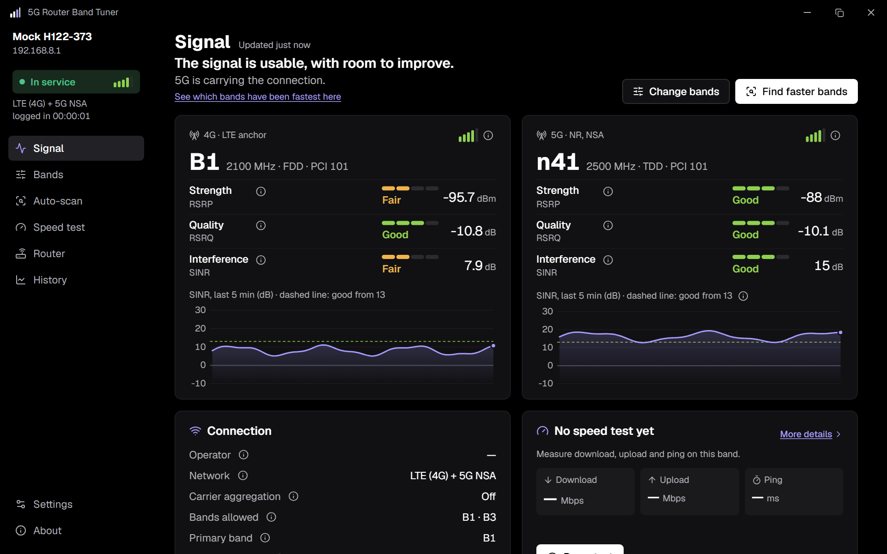
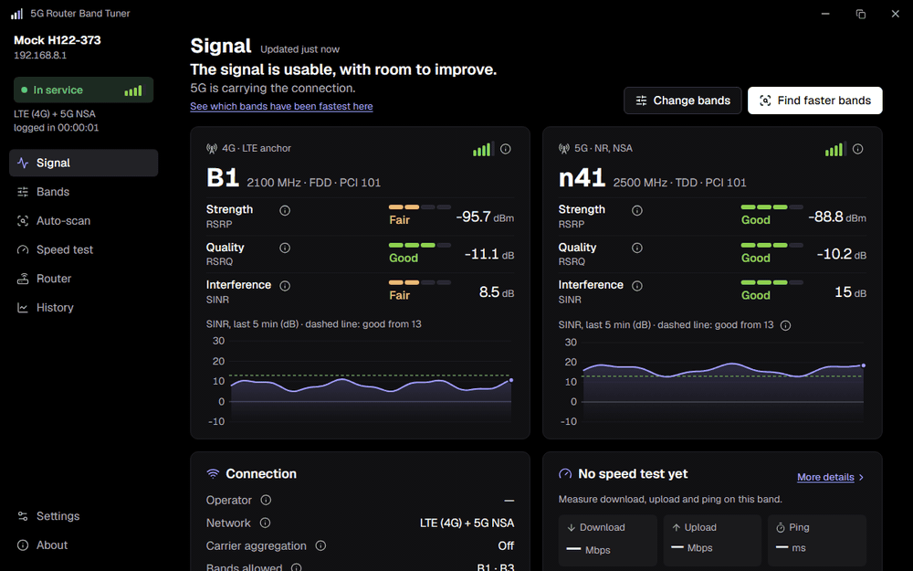
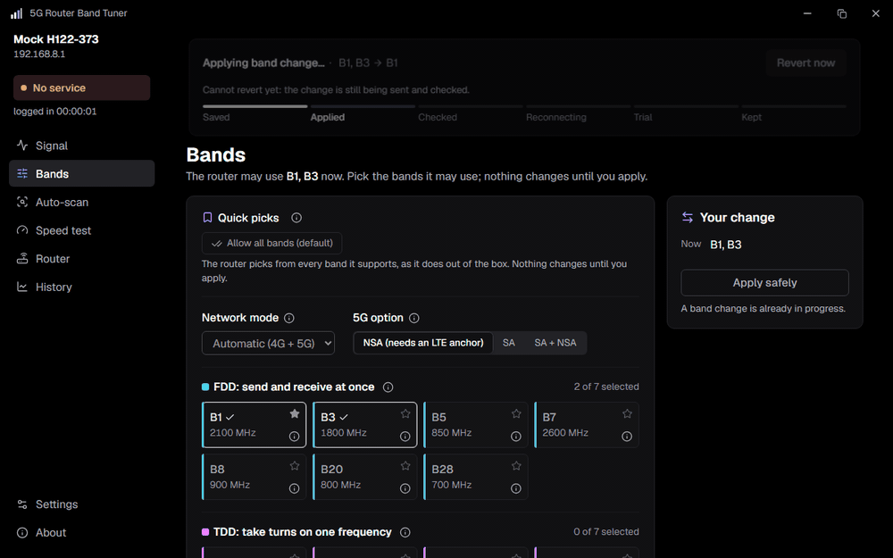
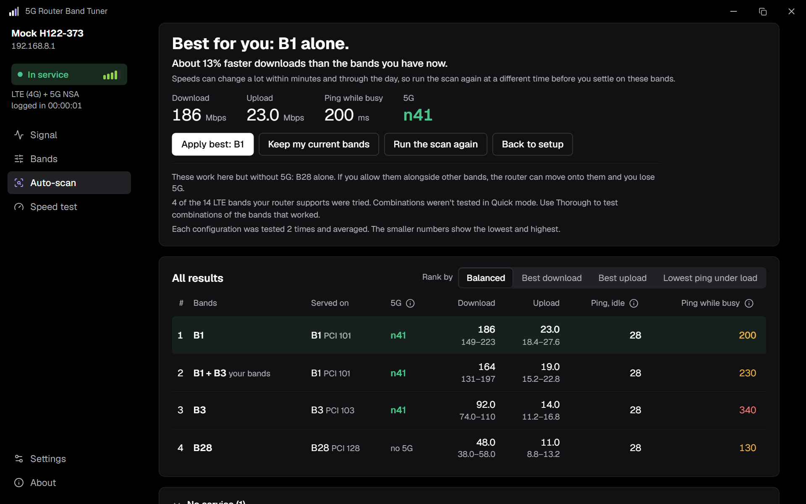
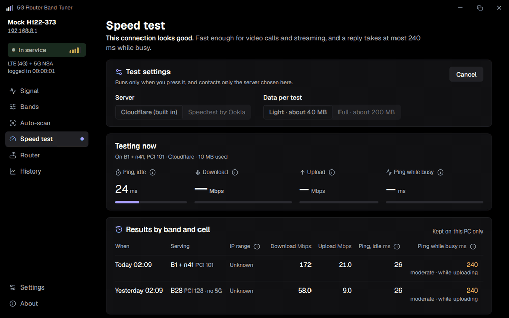
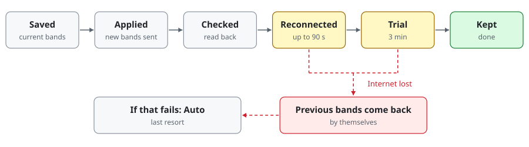

  &nbsp;

  

<h1 align="center">5G Router Band Tuner</h1>

<strong>Find and lock the best 4G/5G bands on your Huawei router, safely.</strong>

  
   
  The newest release, for 64-bit Windows. Free, and no account is needed. <a href="#download-and-install">Install help</a>

  
  
  
  
  
  

  

On a 5G home router, the signal can be strong while the connection is poor, often because of interference from nearby cells. Locking the router to a better set of bands can fix that, but a bad choice can leave you with no internet. This app lets you try bands without that risk: if the internet doesn't come back, your previous bands return by themselves.

<table>
  <tr>
    <td width="50%"><strong>Live 4G/5G signal</strong> Strength, quality and interference in plain words, updated about once a second.</td>
    <td width="50%"><strong>Safe band changes with auto-revert</strong> Each change is checked and put on trial, and undone by itself if the internet is lost.</td>
  </tr>
  <tr>
    <td><strong>Primary band ⭐</strong> Star a band to settle on it first, then allow the rest of your set.</td>
    <td><strong>Auto-scan</strong> Tries band sets one at a time, measures each and ranks the results.</td>
  </tr>
  <tr>
    <td><strong>Built-in speed test</strong> Cloudflare by default, or the optional Ookla CLI, with results saved per band.</td>
    <td><strong>Private and local</strong> No account, no servers of ours and no telemetry. Your router password stays in Windows Credential Manager.</td>
  </tr>
  <tr>
    <td colspan="2"><strong>Multi-language</strong> (English, Arabic, more coming)</td>
  </tr>
</table>

Also in the app:

- **Refresh IP:** asks the network for a new internet address by making the router search for its network again and reconnect. Expect a short internet drop while it runs; the search can't be stopped midway.
- **APN profiles:** see the router's APNs on the Router page, switch to another one with the same automatic undo as a band change, and add, edit or delete the ones that aren't in use. The H122-373 refuses to show its APNs to the app for now, so this stays hidden on that router.
- **Log out:** ends the app's session on the router, and the app stays logged out until you press Connect.
- **History:** opens on one answer, which bands have been fastest for you, with the charts and tables (signal, every speed test, speed by bands and by IP range, what happened) in sections you open when you want them.
- **Privacy check:** on a button press, shows whether your operator's remote management (TR-069) is set up on the router, the devices on your network, whether the router can be reached from the internet, and which DNS server answers your PC. It only reads, and what it reads isn't saved.

## Screenshots

These were recorded with made-up demo values, not a real router.

### Signal

### Bands, with a safe change in progress

The change is applied and checked, the router reconnects, then a trial counts down until the bands are kept.

### Auto-scan results

### Speed test

## Download and install

1. Press [**Download for Windows**](https://github.com/Hjbiki/5g-router-band-tuner/releases/latest/download/5G-Router-Band-Tuner-Setup.exe). It always gets the newest release, and you don't need a GitHub account.
2. Run the file. The installer gets the WebView2 runtime if your PC doesn't have it.

**Don't want to install?** Get the [**portable version**](https://github.com/Hjbiki/5g-router-band-tuner/releases/latest/download/5G-Router-Band-Tuner-Portable.exe): one file that you just run. It keeps its settings in your Windows profile, like the installed app. If nothing opens, use the installer.

Older versions, pre-releases and an `.msi` installer are on the [Releases page](https://github.com/Hjbiki/5g-router-band-tuner/releases).

**Windows may warn you.** The downloads aren't code-signed yet, so SmartScreen can show "Windows protected your PC". To continue, choose **More info**, then **Run anyway**.

**Pre-releases:** the button never downloads one. Most of what's new in a pre-release has only been tested against the demo router, not on real hardware. [The device checklist](docs/DEVICE_CHECKLIST.md) shows what's been confirmed.

## First run

1. **Pick your language.** A short guide opens the first time you start the app.
2. **Enter your router's password.** It's the one you use for the router's web page, usually at `192.168.8.1`. If you never changed it, look on the label under the router.
3. **Read how band changes stay safe,** then start using the app.

To try the app without a router, go to **Settings**, set the router driver to **Demo (no router)** and use the password `mock`.

## How safe-apply works

- **Reconnect:** the router gets up to 90 seconds to come back on the new bands, so expect a short internet drop.
- **Trial:** for 3 minutes the app watches the connection. If the internet stays down for 60 seconds, the change is undone.
- **Your call:** press **Keep these bands** to accept early or **Revert now** to go back. If you press neither, the change is kept when the trial ends.
- **Closing the app is fine:** it keeps watching from the tray. If the app or PC stops mid-change, it finishes or undoes the change when it starts again.

All timers can be changed in Settings. [How it works](docs/HOW_IT_WORKS.md) has the full details.

## Supported routers

| Router | Firmware | Status |
| --- | --- | --- |
| Huawei H122-373 | 11.0.2.21 | Login, signal, band changes and auto-revert tested on a real router |

### Help add your router

If your router isn't supported, the app says so and offers to make a small report. You don't need your router's password for this, and you can read everything in the file before saving it. Then [open the New router form](https://github.com/Hjbiki/5g-router-band-tuner/issues/new?template=new-router.yml) and attach it.

## FAQ

**Can this break my router?**
Band changes are ordinary router settings, and the app undoes one that loses the internet. Shutting the router down isn't possible from the app. A factory reset, which erases the router's settings, is sent only after you confirm a warning, and it stays disabled on a model until its exact call is verified. Changing radio settings can still interrupt your internet, so use it at your own risk.

**Why did my internet drop when I changed bands?**
The router has to reconnect to the network after each change. That usually takes under a minute, and sometimes up to about a minute and a half.

**Which bands should I pick?**
It depends on the towers near you, so start with Auto-scan. It measures each set and ranks them, and nothing stays changed until you choose.

**Does the speed test use my data?**
Only when you press it, during an auto-scan, or on a schedule if you turn on automatic tests in Settings (off by default). A Cloudflare test uses about 40 MB on Light and about 200 MB on Full, and Auto-scan runs two tests for each band set it tries by default, or three in Thorough.

**Does this work with other Huawei routers?**
Only the H122-373 has been tested. If the app doesn't recognise yours, it will offer to help you report it.

**Is this an official Huawei or operator app?**
No. It's an independent project, and its source code is public.

## Privacy

- **What it connects to:** your router, the speed test server when you run a test (or on a schedule, if you turn automatic tests on), and GitHub to look for a new version if you allow it. Pressing **Check DNS** in the Privacy check sends one ordinary DNS lookup (`whoami.akamai.net`) to find which DNS server answers your PC. Nothing else.
- **Speed tests:** Cloudflare by default. If you choose Ookla and accept its terms, its official CLI is downloaded on first use, and Ookla receives your results and IP address. [Details](docs/SPEEDTEST.md).
- **Your password:** it's kept in Windows Credential Manager, and never in settings, logs or crash output.
- **No telemetry:** the update check is off unless you allow it, and it only reads the latest release from GitHub.
- **History stays on this PC:** the signal, speed tests and events on the History page are kept in `history.db` in the app data folder, 90 days by default. A CSV export leaves out cell numbers (PCI and channel) unless you tick the box, and never includes cell or tower IDs.
- **Local files can locate you:** `events.jsonl` and `history.db` hold cell details, so don't post them publicly. For a bug report, use **About › Export diagnostics…**, which replaces identifiers with made-up values and shows you the result before saving.
- **Plain HTTP:** the router only speaks plain HTTP. The password isn't sent in the clear, but other traffic to the router can be seen on your network, so use the app on a network you trust.

## Contributing

Reports from other routers help the most. If yours isn't supported, **About › Record** captures how its own page talks to it, with everything private hidden, so it can be added. [CONTRIBUTING.md](CONTRIBUTING.md) explains how to report a router or operator, how to build the app and how to add a driver.

## License

[PolyForm Noncommercial License 1.0.0](LICENSE). You may use, share and change the app for any noncommercial purpose, as long as the licence and the copyright notice stay with every copy. Commercial use, including selling it, isn't allowed. Copyright © 2026 Anad Askar.

Unofficial, and not affiliated with or endorsed by Huawei or any operator. Product and operator names and logos belong to their owners.

## Credits

Developed by [Anad Askar](https://creators.sa/hibiki).
