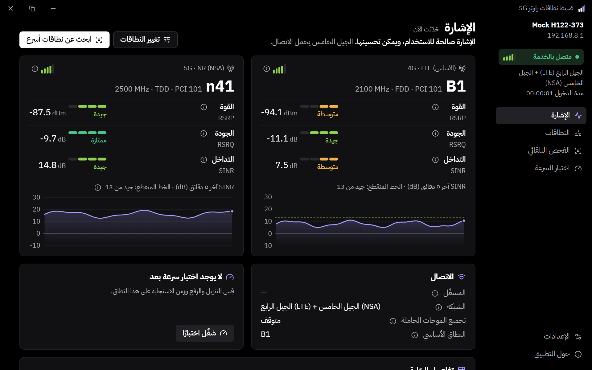
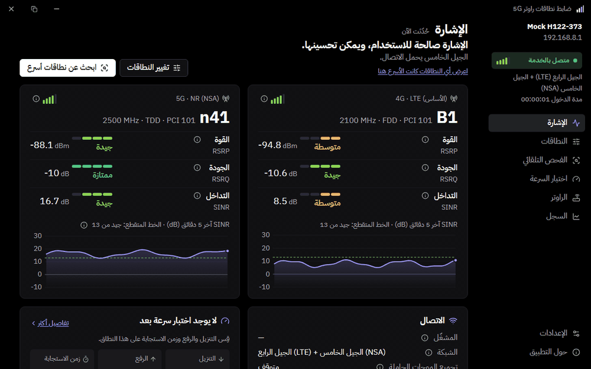
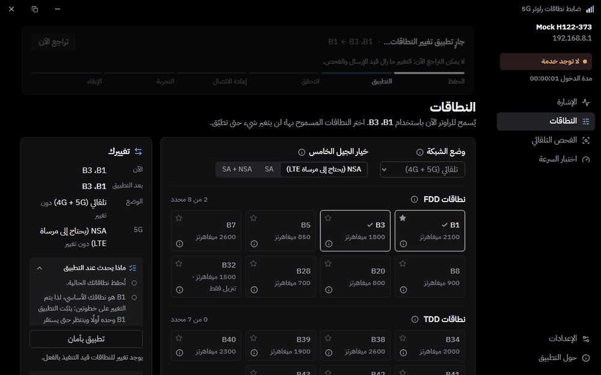
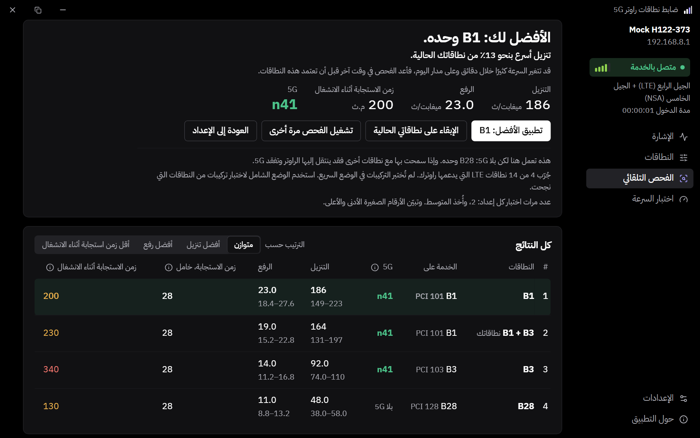
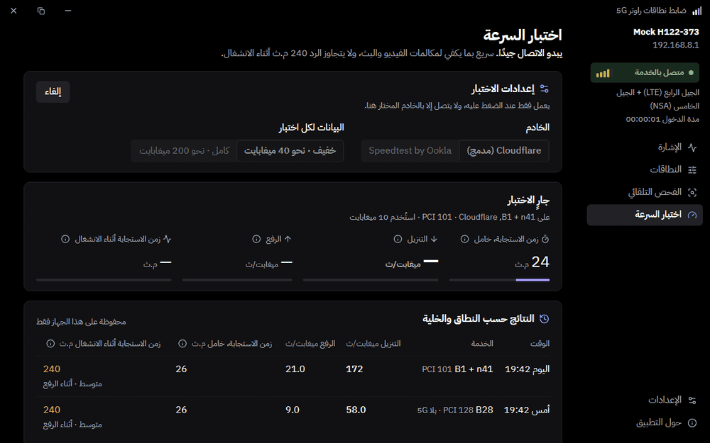
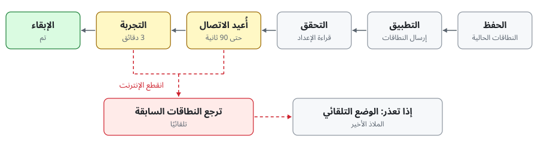

  &nbsp;

  

<h1 align="center">ضابط نطاقات راوتر 5G</h1>

<strong>اعثر على أفضل نطاقات 4G و5G لراوتر هواوي وثبّتها بأمان.</strong>

  
   
  أحدث إصدار، لويندوز 64 بت. مجاني، ولا يحتاج إلى حساب. <a href="#التنزيل-والتثبيت">المساعدة في التثبيت</a>

  
  
  
  
  
  

  

في راوتر 5G المنزلي قد تكون الإشارة قوية والاتصال ضعيفًا، وكثيرًا ما يكون السبب تداخل الأبراج القريبة. وقد يحل ذلك تثبيت الراوتر على نطاقات (باندات) أفضل، لكن الاختيار الخاطئ قد يتركك بلا إنترنت. يتيح لك هذا التطبيق تجربة النطاقات دون هذه المخاطرة: إذا لم يعد الإنترنت، ترجع نطاقاتك السابقة تلقائيًا.

<table>
  <tr>
    <td width="50%"><strong>إشارة 4G و5G مباشرة</strong> القوة والجودة والتداخل بكلام مفهوم، وتتحدّث كل ثانية تقريبًا.</td>
    <td width="50%"><strong>تغيير آمن للنطاقات مع رجوع تلقائي</strong> يُفحص كل تغيير ويخضع لفترة تجربة، ويُلغى تلقائيًا إذا انقطع الإنترنت.</td>
  </tr>
  <tr>
    <td><strong>النطاق الأساسي ⭐</strong> ميّز نطاقًا بنجمة ليستقر الراوتر عليه أولًا، ثم يُسمح ببقية نطاقاتك.</td>
    <td><strong>فحص تلقائي</strong> يجرّب مجموعات النطاقات واحدة تلو الأخرى، ويقيس كل مجموعة ويرتّب النتائج.</td>
  </tr>
  <tr>
    <td><strong>اختبار سرعة مدمج</strong> عبر Cloudflare افتراضيًا أو أداة Ookla الاختيارية، وتُحفظ النتائج لكل نطاق.</td>
    <td><strong>خصوصية وعمل محلي</strong> بلا حساب ولا خوادم تابعة لنا ولا بيانات تتبّع. وتبقى كلمة مرور الراوتر في مدير بيانات الاعتماد في ويندوز.</td>
  </tr>
  <tr>
    <td colspan="2"><strong>متعدد اللغات</strong> (الإنجليزية والعربية، والمزيد قادم)</td>
  </tr>
</table>

وفي التطبيق أيضًا:

- **تحديث عنوان IP:** يطلب من الشبكة عنوان إنترنت جديدًا بجعل الراوتر يبحث عن شبكته من جديد ثم يعيد الاتصال. توقّع انقطاعًا قصيرًا في الإنترنت أثناء البحث، ولا يمكن إيقاف البحث قبل انتهائه.
- **ملفات APN:** اعرض ملفات APN في الراوتر من صفحة الراوتر، وانتقل إلى ملف آخر مع التراجع التلقائي نفسه المستخدم في تغيير النطاقات، وأضف الملفات غير المستخدمة أو عدّلها أو احذفها. يرفض H122-373 حاليًا عرض ملفات APN للتطبيق، فيبقى هذا مخفيًا في ذلك الراوتر.
- **تسجيل الخروج:** ينهي جلسة التطبيق في الراوتر، ويبقى التطبيق خارج الجلسة حتى تضغط «اتصال».
- **السجل:** يبدأ بإجابة واحدة، وهي النطاقات الأسرع لديك، وتبقى الرسوم والجداول (الإشارة، وكل اختبارات السرعة، والسرعة حسب النطاقات وحسب نطاق IP، وما الذي حدث) في أقسام تفتحها حين تريد.
- **فحص الخصوصية:** بضغطة زر، يعرض هل إدارة المشغّل عن بُعد (TR-069) مضبوطة في الراوتر، والأجهزة الموجودة في شبكتك، وهل يمكن الوصول إلى الراوتر من الإنترنت، وأي خادم DNS يجيب جهازك. يقرأ فقط، ولا يحفظ ما يقرؤه.

## لقطات الشاشة

سُجّلت هذه اللقطات بقيم تجريبية مختلقة، لا من راوتر حقيقي.

### الإشارة

### النطاقات أثناء تغيير آمن

يُطبَّق التغيير ويُفحص، ثم يعيد الراوتر الاتصال، ثم يبدأ عدّ تنازلي لفترة التجربة حتى تُعتمد النطاقات.

### نتائج الفحص التلقائي

### اختبار السرعة

## التنزيل والتثبيت

1. اضغط [**تنزيل لويندوز**](https://github.com/Hjbiki/5g-router-band-tuner/releases/latest/download/5G-Router-Band-Tuner-Setup.exe). ينزّل دائمًا أحدث إصدار، ولا تحتاج إلى حساب في GitHub.
2. شغّل الملف. يجلب المثبّت مكوّن WebView2 إذا لم يكن موجودًا في جهازك.

**لا تريد التثبيت؟** نزّل [**النسخة المحمولة**](https://github.com/Hjbiki/5g-router-band-tuner/releases/latest/download/5G-Router-Band-Tuner-Portable.exe): ملف واحد تشغّله مباشرة. تحفظ إعداداتها في ملفك الشخصي على ويندوز مثل النسخة المثبّتة. إذا لم يفتح شيء فاستخدم المثبّت.

الإصدارات الأقدم والإصدارات التجريبية ومثبّت MSI موجودة في [صفحة الإصدارات](https://github.com/Hjbiki/5g-router-band-tuner/releases).

**قد يحذّرك ويندوز.** ملفات التنزيل غير موقّعة رقميًا بعد، فقد تظهر رسالة SmartScreen «Windows protected your PC». للمتابعة اختر **More info** ثم **Run anyway**.

**الإصدارات التجريبية:** الزر لا ينزّلها أبدًا. معظم الجديد في الإصدار التجريبي لم يُختبر إلا على الراوتر التجريبي، لا على جهاز حقيقي. وتبيّن [قائمة فحص الجهاز](docs/DEVICE_CHECKLIST.md) ما جرى تأكيده.

## التشغيل الأول

1. **اختر لغتك.** يفتح دليل قصير عند تشغيل التطبيق أول مرة.
2. **أدخل كلمة مرور الراوتر.** وهي التي تستخدمها لصفحة إعدادات الراوتر، وعنوانها عادةً `192.168.8.1`. وإذا لم تغيّرها من قبل، فانظر إلى الملصق أسفل الراوتر.
3. **اقرأ كيف تبقى تغييرات النطاقات آمنة،** ثم ابدأ استخدام التطبيق.

لتجربة التطبيق دون راوتر، افتح **الإعدادات**، واختر **تجريبي (بدون راوتر)** في **مشغّل الراوتر**، واستخدم كلمة المرور `mock`.

## كيف يعمل التطبيق الآمن

- **إعادة الاتصال:** يأخذ الراوتر حتى 90 ثانية ليعود على النطاقات الجديدة، فتوقّع انقطاعًا قصيرًا في الإنترنت.
- **التجربة:** يراقب التطبيق الاتصال 3 دقائق. وإذا بقي الإنترنت مقطوعًا 60 ثانية، يُلغى التغيير.
- **القرار لك:** اضغط **الإبقاء على هذه النطاقات** لتعتمدها مبكرًا أو **تراجع الآن** لتعود. وإذا لم تضغط أيًّا منهما، يُعتمد التغيير عند انتهاء التجربة.
- **لا بأس بإغلاق النافذة:** يواصل التطبيق المراقبة من شريط المهام. وإذا توقف التطبيق أو الجهاز أثناء التغيير، يُكمله أو يلغيه عند التشغيل التالي.

يمكن تغيير كل المدد من الإعدادات. وفي [طريقة العمل](docs/HOW_IT_WORKS.md) التفاصيل الكاملة (بالإنجليزية).

## الراوترات المدعومة

| الراوتر | البرنامج الثابت | الحالة |
| --- | --- | --- |
| Huawei H122-373 | 11.0.2.21 | جرى اختبار الدخول والإشارة وتغيير النطاقات والرجوع التلقائي على راوتر حقيقي |

### ساعد في إضافة راوترك

إذا لم يكن راوترك مدعومًا، يخبرك التطبيق بذلك ويعرض إنشاء تقرير صغير. لا تحتاج إلى كلمة مرور الراوتر لهذا، ويمكنك قراءة كل ما في الملف قبل حفظه. ثم [افتح نموذج الراوتر الجديد](https://github.com/Hjbiki/5g-router-band-tuner/issues/new?template=new-router.yml) وأرفقه به.

## الأسئلة الشائعة

**هل يمكن أن يتلف هذا الراوتر؟**
تغيير النطاقات إعداد عادي في الراوتر، ويلغي التطبيق أي تغيير يقطع الإنترنت. ولا يمكن إيقاف تشغيل الراوتر من التطبيق. ولا تُرسل إعادة ضبط المصنع، وهي تمسح إعدادات الراوتر، إلا بعد أن تؤكد تحذيرًا، وتبقى معطّلة في أي طراز حتى يُتحقق من أمرها بالضبط. ومع ذلك قد يقطع تغيير إعدادات الراديو الإنترنت، فاستخدمه على مسؤوليتك.

**لماذا انقطع الإنترنت عند تغيير النطاقات؟**
يحتاج الراوتر إلى إعادة الاتصال بالشبكة بعد كل تغيير. ويستغرق ذلك غالبًا أقل من دقيقة، وأحيانًا نحو دقيقة ونصف.

**أي النطاقات أختار؟**
يعتمد ذلك على الأبراج القريبة منك، فابدأ بالفحص التلقائي. فهو يقيس كل مجموعة ويرتّبها، ولا يبقى أي تغيير حتى تختار.

**هل يستهلك اختبار السرعة باقتي؟**
فقط عند الضغط عليه، وأثناء الفحص التلقائي، وفي مواعيد ثابتة إذا شغّلت الاختبارات التلقائية في الإعدادات (متوقفة افتراضيًا). يستهلك اختبار Cloudflare نحو 40 ميجابايت في الوضع الخفيف ونحو 200 ميجابايت في الكامل، ويُجري الفحص التلقائي افتراضيًا اختبارين لكل مجموعة نطاقات، أو ثلاثة في الوضع الشامل.

**هل يعمل مع راوترات هواوي الأخرى؟**
لم يُختبر إلا H122-373. وإذا لم يتعرف التطبيق على راوترك، فسيعرض مساعدتك في الإبلاغ عنه.

**هل هذا تطبيق رسمي من هواوي أو من مشغّل؟**
لا. إنه مشروع مستقل، وشيفرته المصدرية منشورة للجميع.

## الخصوصية

- **بماذا يتصل:** الراوتر، وخادم اختبار السرعة عند تشغيل اختبار (أو في مواعيد ثابتة إذا شغّلت الاختبارات التلقائية)، وGitHub للبحث عن إصدار جديد إذا سمحت بذلك. والضغط على **افحص DNS** في فحص الخصوصية يرسل استعلام DNS عاديًا واحدًا (`whoami.akamai.net`) لمعرفة أي خادم DNS يجيب جهازك. ولا شيء غيرها.
- **اختبارات السرعة:** عبر Cloudflare افتراضيًا. وإذا اخترت Ookla ووافقت على شروطها، تُنزَّل أداتها الرسمية عند أول استخدام، وتتلقى Ookla نتائجك وعنوان IP الخاص بك. [التفاصيل](docs/SPEEDTEST.md) (بالإنجليزية).
- **كلمة المرور:** تُحفظ في مدير بيانات الاعتماد في ويندوز، ولا تُكتب أبدًا في الإعدادات أو السجلات أو تقارير الأعطال.
- **بلا بيانات تتبّع:** البحث عن التحديثات متوقف ما لم تسمح به، ولا يقرأ إلا أحدث إصدار من GitHub.
- **السجل يبقى على هذا الجهاز:** تُحفظ الإشارة واختبارات السرعة والأحداث المعروضة في صفحة السجل في `history.db` داخل مجلد بيانات التطبيق، لمدة 90 يومًا افتراضيًا. ولا يتضمن تصدير CSV أرقام الخلايا (PCI والقناة) إلا إذا اخترت ذلك، ولا يتضمن أبدًا معرّفات الخلايا أو الأبراج.
- **الملفات المحلية قد تكشف موقعك:** يحتوي `events.jsonl` و`history.db` على تفاصيل الأبراج، فلا تنشرهما علنًا. وللإبلاغ عن مشكلة استخدم **حول التطبيق › تصدير التشخيص…**، إذ يستبدل المعرّفات بقيم مختلقة ويعرض لك النتيجة قبل الحفظ.
- **HTTP غير مشفّر:** لا يتعامل الراوتر إلا بـ HTTP غير المشفّر. لا تُرسل كلمة المرور بنص واضح، لكن يمكن رؤية بقية الاتصال بالراوتر على شبكتك، فاستخدم التطبيق على شبكة تثق بها.

## المساهمة

أكثر ما يفيد هو التقارير عن راوترات أخرى. وإن كان راوترك غير مدعوم، فإن **حول التطبيق › سجّل** يسجّل طريقة تعامل صفحته معه بعد إخفاء كل ما هو خاص، ليُضاف دعمه. ويشرح [CONTRIBUTING.md](CONTRIBUTING.md) (بالإنجليزية) كيفية الإبلاغ عن راوتر أو مشغّل، وبناء التطبيق، وإضافة برنامج تشغيل.

## الرخصة

[رخصة PolyForm Noncommercial 1.0.0](LICENSE). يمكنك استخدام التطبيق ومشاركته وتعديله لأي غرض غير تجاري، بشرط أن تبقى الرخصة وإشعار حقوق النشر مع كل نسخة. ولا يُسمح بالاستخدام التجاري، ومنه البيع. حقوق النشر © 2026 عناد عسكر.

مشروع غير رسمي، وغير تابع لهواوي أو لأي مشغّل وغير معتمد منهم. وأسماء المنتجات والمشغّلين وشعاراتهم ملك لأصحابها.

## الشكر

تطوير [عناد عسكر](https://creators.sa/hibiki).

**عبارات بحث شائعة:** تثبيت الباند، قفل الباند، قفل البرج، تثبيت البرج، راوتر 5G هواوي، راوتر هواوي H122-373، تحسين إشارة الراوتر، رفع سرعة الإنترنت 5G، تغيير الباند، زين 5G، SINR.

